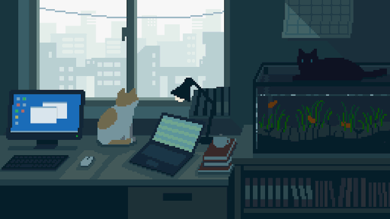

<p align="center">
  
</p>

```console
guest@hqvi:~$ who
hqvi left this session open. that was three builds ago.
```

## Session stats

<p align="center">
  
  
</p>

## Contribution grid

<picture>
  <source media="(prefers-color-scheme: dark)" srcset="https://raw.githubusercontent.com/hqvi/hqvi/snake-output/snake-dark.svg" />
  
</picture>
