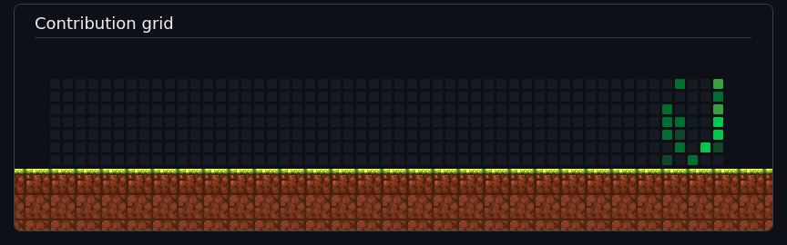

<p align="center">
  
</p>

<p align="center">
  
</p>

## GitHub stats

<p align="center">
  
  
</p>

## How the contribution grid works

The animation turns the repository owner’s GitHub contribution calendar into a pixel-art scene. A contribution day becomes one block. Busier days are brighter and take more pickaxe hits. Havi mines every green block that survives the encounter.

The ghastling fends off the chicken jockey. Then the cat scares the creeper away, the creeper clears nearby green blocks, or it explodes over empty ground. The positions and counts in your calendar change how the scene plays out. A denser grid makes a cluster blast more likely.

The README shows one looping GIF. GitHub Actions chooses an encounter and refreshes the image daily. The optional interactive page rolls a fresh encounter on each load or replay. The blocks disappear only inside the animation. GitHub keeps the original contribution history.

## Use it on your own profile

1. Copy the project files, including `.github/workflows/contribution-grid.yml`, into the root of a public repository named exactly like your GitHub username. If you already have a profile README, keep it and copy the contribution image line into it.
2. If you use the whole README, replace `hqvi` in the stats URLs and update the greeting in `profile/intro.svg`.
3. Open **Actions → Contribution grid → Run workflow** on your default branch. Leave the encounter on **auto** or choose one to test. The workflow requests the repository owner’s calendar and updates `output/contribution-grid.gif`.
4. If the calendar request is denied with the default repository token, add a GitHub token with calendar read access as an Actions secret called `CONTRIBUTION_TOKEN`. To keep the generated calendar limited to public data, avoid using a token that can read private contribution details. Only the repository token is used to push the generated GIF.
5. For an optional interactive version, set **Settings → Pages → Build and deployment → Source** to **GitHub Actions**, then add the repository variable `ENABLE_GRID_PAGES` with value `true` under **Settings → Secrets and variables → Actions → Variables**. Run the workflow, then link your Pages URL from your README.

The update commits to the default branch, so that branch must allow the workflow to push. If you see the old image after a successful run, allow GitHub’s image cache to refresh.

The workflow uses the account that owns the destination repository. A copy under your username will use your grid automatically. The starter GIF uses sample data until the first successful refresh.

### Run it locally

Open `grid/index.html` for the sample calendar. For a sample GIF, install Node.js 22+, Python 3.11+, and FFmpeg, then run these commands in order:

```sh
npm install
npx playwright install chromium
python scripts/calendar.py --sample
node scripts/render-grid.mjs --scenario cat
```

The calendar builder creates `build/site/index.html` with the sample data or the API result embedded. The renderer records that same canvas animation as a GIF.
